  

Sou desenvolvedor de software na **Diretoria de Tecnologia da Universidade de Fortaleza (UNIFOR)**, onde construo APIs e sistemas corporativos com **Java, Spring Boot, Quarkus e Angular**, usando **Kafka, RabbitMQ e Airflow** para integração e orquestração.

Meu foco é backend, arquitetura de software, qualidade de código e soluções escaláveis, sem perder de vista o frontend e o produto como um todo.

**[LinkedIn](https://www.linkedin.com/in/felipe-dias-mac-dowell-255578193/)** · **[Repositórios](https://github.com/felipe11dias?tab=repositories)**

## Projetos em destaque

**Sistema de gestão compartilhada de restaurantes**, feito em grupo no Tech Challenge da pós-graduação. O build falha se a cobertura unitária ficar abaixo de 100% ou se a regra de dependência da Clean Architecture for violada, e os testes de integração rodam contra um PostgreSQL real com Testcontainers.

*Stack:* Java 21, Spring Boot 3.5, Spring Security com JWT, PostgreSQL, Flyway, Docker, JUnit 5, Testcontainers, ArchUnit e JaCoCo. 
*Links:* [repositório](https://github.com/felipe11dias/postech-fase2-restaurantes-app) · [vídeo de apresentação](https://www.youtube.com/watch?v=N0ckKiKnPcw)

**Plataforma que reúne corretores e clientes**, com anúncios de imóveis e automóveis, busca por raio, busca salva com notificações, propostas nas duas direções, reputação e moderação. A Fase 2 está em andamento.

*Stack:* Java 21, Spring Boot 3.5, Spring Security com JWT, HATEOAS, PostgreSQL, Flyway, AWS SDK (S3), MinIO e Docker. 
*Links:* [repositório](https://github.com/felipe11dias/corretoria-social)

**A mesma API implementada em camadas e em hexagonal**, lado a lado, para comparar na prática o que cada arquitetura entrega e o que cobra em troca.

*Stack:* Java 21, Spring Boot, JdbcTemplate, PostgreSQL, Flyway, JWT e Docker. 
*Links:* [repositório](https://github.com/felipe11dias/postech-restaurantes-app)

**Presença digital de uma consultoria imobiliária de galpões em Fortaleza.** O site em produção é estático, com SEO completo e conversão via WhatsApp. O monorepo traz uma landing page em Angular 19 com SSR e um design system próprio documentado em Storybook.

*Stack:* HTML, SCSS, Bootstrap, Angular 19, Nx, Tailwind CSS e Storybook. 
*Links:* [site](https://fortegalpoes.com) · [repositório do site](https://github.com/felipe11dias/forte-galpoes-site) · [monorepo Angular](https://github.com/felipe11dias/Forte-Galpoes-Monorepo)

**Meu Trabalho de Conclusão de Curso em Ciência da Computação:** um ambiente colaborativo de jogos sérios para alunos da graduação. Professores cadastram disciplinas e atividades, e alunos as jogam em três formatos diferentes e acompanham o ranking.

*Stack:* React, TypeScript, Redux Toolkit e Material UI no frontend; Java 17, Spring Boot 3, Spring Security com JWT e PostgreSQL no backend. 
*Links:* [frontend](https://github.com/felipe11dias/jogo-serio-tradicional) · [backend](https://github.com/felipe11dias/jogos-serio-tradicional-java)

<strong>Outros projetos</strong>

 

- [`library-spring-boot-4`](https://github.com/felipe11dias/library-spring-boot-4): estudo de Spring Boot 4 com JWT, HATEOAS e Flyway.
- [`TreinamentoVendas`](https://github.com/felipe11dias/TreinamentoVendas): estudo de Spring Boot, JPA, API REST, Security e JWT.
- [`React-redux`](https://github.com/felipe11dias/React-redux): estudo de gerenciamento de estado com React e Redux.
- [`DesafioNati-Back`](https://github.com/felipe11dias/DesafioNati-Back) e [`DesafioNati-Front`](https://github.com/felipe11dias/DesafioNati-Front): desafio de backend e frontend.

## Stack

  

| Área | Tecnologias |
| --- | --- |
| **Backend** | Java, Spring, Spring Boot, Quarkus, REST API, JPA, MyBatis |
| **Mensageria e orquestração** | Apache Kafka, RabbitMQ, Apache Airflow |
| **Frontend** | Angular, TypeScript, JavaScript, React, HTML5, CSS3, SCSS, Bootstrap |
| **Banco de dados** | Oracle, PostgreSQL, MySQL |
| **Ferramentas** | Docker, Git, GitHub |

## Experiência

### Universidade de Fortaleza (UNIFOR)

**Desenvolvedor Web Pleno** · Diretoria de Tecnologia

Análise, desenvolvimento, manutenção e evolução dos sistemas Web da instituição:

- APIs e serviços backend com Java, Spring e Quarkus;
- mensageria com Kafka e RabbitMQ e orquestração de pipelines com Airflow;
- frontend com Angular e TypeScript;
- bancos de dados Oracle, MySQL e PostgreSQL;
- integração entre sistemas, análise e correção de problemas;
- testes automatizados, planejamento e definição de soluções técnicas.

## Formação

- **Pós-graduação em Desenvolvimento Backend Java e Spring**, FIAP (2026 – 2027)
- **Ciência da Computação**, Universidade de Fortaleza (UNIFOR)

Formação complementar em lógica de programação, orientação a objetos, JavaScript, APIs RESTful, aplicações Android e levantamento e documentação de requisitos.

**"Transformando problemas em soluções através da tecnologia."**

[LinkedIn](https://www.linkedin.com/in/felipe-dias-mac-dowell-255578193/) · [GitHub](https://github.com/felipe11dias) · [Facebook](https://www.facebook.com/share/1Ep2QC1Mih/)

Obrigado pela visita!

